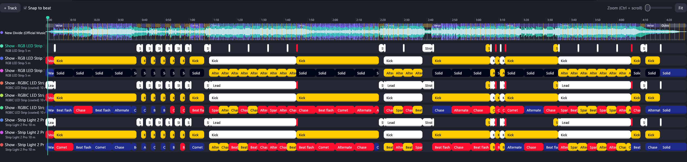
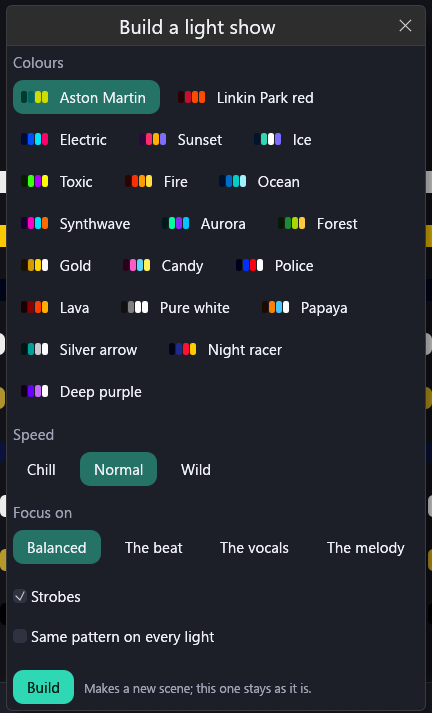
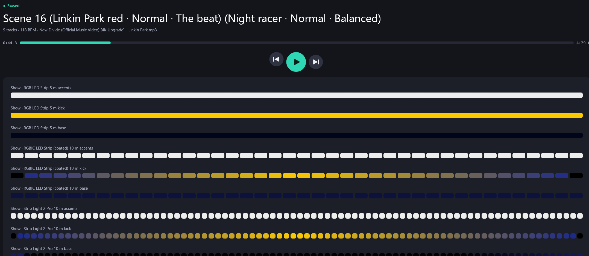
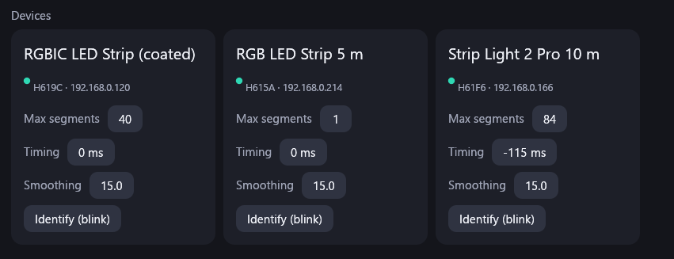
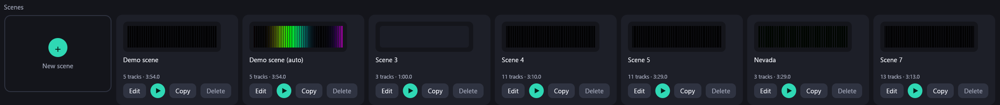

# Lightline

A light-show editor for **Govee** LED lights. Put effects on a timeline like a video editor, sync them to a song, and play the show on your lights over your home network. Or let the lights react live to whatever your PC is playing.

Native Windows app written in Rust: a single ~7 MB `.exe`, no browser engine, no account, no cloud.



## Features

- **Timeline editor:** tracks per light, drag-and-drop effects, resize and move clips, zoom, snap to beat, undo/redo, copy/paste.
- **Music sync:** import an MP3/M4A. Lightline finds the tempo, every beat and bar, and the song's parts (intro, verse, chorus, stops, outro), shown above the timeline.
- **33 effects in two groups:**
  - **Reacts to the music:** Visualizer, Spectrum, Kick, Ripple, Bass VU, Hi-hats, Snare, Glitch, Voice, Lead (follows the melody), Drop flash, Treble, Meter, Bass hit.
  - **Patterns on the beat:** Chase, Comet, Scanner, Converge, Stack, Riser, Heartbeat, Beat flash, Strobe, Wave, Fire, Rainbow, Colour jump and more.
- **Per-clip controls:** two colours or a colour list, brightness, speed, reverse, fades, mirror, repeat, "reacts to" (kick/bass/vocals/highs) and crossfade/wipe transitions.
- **Layers:** several tracks can drive one light; the higher track wins, and its dark parts let the tracks below show through.
- **Build show:** generates a full layered show for a song. You pick the colour set (20 of them), the speed (Chill/Normal/Wild), what it focuses on (beat, vocals or melody) and whether it strobes. Every build is a new variation.
- **React to PC audio:** the lights follow whatever is playing on the PC (Spotify, YouTube, games) in real time, no song import needed.
- **Live page:** play scenes full screen, hold **F** to flash every light white, **B** for blackout.
- **Per-light tuning:** timing offset (to line up slower lights), smoothing, and the number of segments each light accepts.





## Supported lights

Any Govee light with **LAN Control** should work. Tested on:

| Model | Light | Notes |
|---|---|---|
| H619C | RGBIC LED Strip (coated) 10 m | 40 segments, keeps up with 120 frames/s |
| H61F6 | Strip Light 2 Pro 10 m | 84 segments, about 24 frames/s |
| H615A | RGB LED Strip 5 m | 1 segment |

Lights without LAN Control (for example the TV Backlight 3 Lite) can't be controlled.



## Getting started

1. In the **Govee Home** app, open each light → settings → turn on **LAN Control**.
2. Download `Lightline.exe` from [Releases](../../releases) and run it. It's a single file with no installer.
3. When Windows asks about network access, allow it, including on **public networks** if your network is set to Public. Otherwise Lightline can't find your lights.
4. Your lights show up on **Home**. Click **New scene**, import a song in the **Editor**, then either drag effects onto the tracks or press **Build show…**.

Requires Windows 10 or 11. Lightline talks to the lights directly on your network (Govee LAN API, UDP); nothing leaves your home.

## Build from source

Needs [Rust](https://rustup.rs).

```
cd src-tauri
cargo build --release
```

The app is at `src-tauri/target/release/lightline.exe`. Run the tests with `cargo test`.

## Good to know

- **Segments:** each light model accepts a fixed maximum number of colours per frame. Send more and it goes dark. Lightline knows the tested models above; for others, set **Max segments** on the light's card on Home.
- **Some lights lag:** the H61F6 shows frames later than the H619C. Use its **Timing** on Home (negative = earlier) to line them up.
- **Settings and scenes** are stored in `%APPDATA%\com.lightline.app`.



## Licence

[GPL-3.0-or-later](LICENSE). Not affiliated with Govee.
